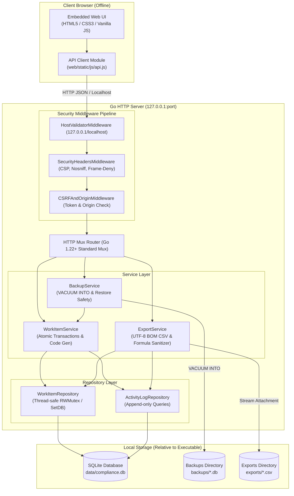
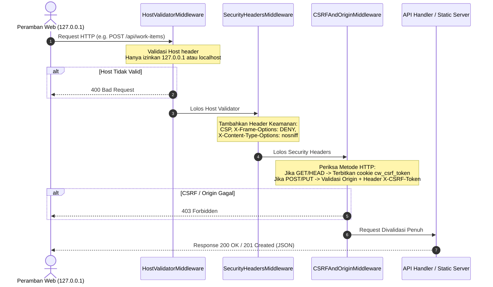

# Arsitektur Sistem Compliance Workspace v1.0

Dokumen ini mendokumentasikan arsitektur teknis, desain komponen, mekanisme komunikasi, serta spesifikasi antarmuka API dari aplikasi **Compliance Workspace v1.0**.

---

## 1. Ikhtisar & Prinsip Desain

Compliance Workspace v1.0 dibangun dengan pendekatan **Local-First, Offline-First, Portable, and Zero-Dependency**. Aplikasi ini dirancang untuk berjalan sebagai executable mandiri pada perangkat pengguna (Windows x64) tanpa memerlukan server web eksternal, runtime terpisah (tanpa Python/Node.js), koneksi internet, maupun database engine mandiri.

### Prinsip Utama
1. **Single Portable Binary**: Seluruh kode backend Go, driver database SQLite, dan aset frontend (HTML, CSS, JS) dikemas dalam satu biner executable (`ComplianceWorkspace.exe`).
2. **Offline by Default**: Berjalan sepenuhnya pada alamat loopback `127.0.0.1` tanpa ketergantungan CDN, cloud hosting, font daring, atau analitik eksternal.
3. **Executable-Relative Paths**: Seluruh penyimpanan (`data/`, `backups/`, `exports/`) diresolusi relatif terhadap lokasi biner fisik executable (`os.Executable()`).
4. **Append-Only Auditability**: Setiap mutasi pekerjaan (*work item*) menghasilkan jejak riwayat aktivitas secara atomik di dalam satu transaksi database SQLite yang dilindungi trigger `ABORT`.
5. **Robust Local Security**: Perlindungan dari Host header spoofing, Origin/Referer check, token CSRF, Content Security Policy (CSP), serta sanitasi injeksi formula spreadsheet (CSV Formula Injection).

---

## 2. Diagram Arsitektur Tingkat Tinggi



---

## 3. Struktur Proyek & Tanggung Jawab Komponen

```text
ComplianceWorkspace/
├── cmd/
│   └── compliance-workspace/
│       └── main.go                 # Titik masuk aplikasi, flag parsing, wiring dependency, graceful shutdown
├── internal/
│   ├── config/
│   │   └── config.go               # Resolusi path executable, validasi hak tulis direktori (write-probe)
│   ├── database/
│   │   ├── db.go                   # Pembukaan koneksi SQLite, PRAGMA setup, migration runner
│   │   └── migrations/
│   │       └── 001_initial_schema.sql # Skema awal DDL tabel, indeks, dan trigger append-only
│   ├── domain/
│   │   └── models.go               # Entitas domain (WorkItem, ActivityLog), konstanta status/prioritas, DTO validasi
│   ├── repository/
│   │   ├── work_item_repo.go       # Operasi SQL tabel work_items, penomoran CMP-YYYY-NNNNNN, penyaringan dinamis
│   │   └── activity_log_repo.go    # Operasi SQL tabel activity_logs (penyisipan dan pembacaan kronologis)
│   ├── server/
│   │   ├── middleware.go           # Pipeline keamanan (Host, CSRF, Origin, CSP, X-Frame-Options)
│   │   └── server.go               # Registrasi endpoint HTTP, handler REST API, static fileserver embed
│   └── service/
│       ├── work_item_service.go    # Logika bisnis atomik (Create, Update, Archive, Restore, AddActivity)
│       ├── backup_service.go       # Mekanisme backup konsisten (VACUUM INTO) dan restore bertingkat aman
│       └── export_service.go       # Generator laporan CSV ber-BOM dengan proteksi formula injection
├── web/
│   ├── embed.go                    # Direktif //go:embed static/* untuk kompilasi aset ke biner
│   └── static/
│       ├── index.html              # Struktur antarmuka SPA responsif (Dashboard, Register, Log, Tracker, Settings)
│       ├── css/
│       │   └── app.css             # Tema profesional, tata letak CSS Grid/Flexbox, badge status, modal dialog
│       └── js/
│           ├── api.js              # Abstraksi klien HTTP Fetch dengan auto CSRF token fetch & retry
│           └── app.js              # State manager UI, event handling, filter tabel, form validation, render DOM
├── scripts/
│   ├── build-portable.ps1          # Skrip automasi build Windows x64 mandiri (CGO_ENABLED=0, zip, checksums)
│   ├── smoke-test-portable.ps1     # Pengujian smoke test portabilitas terisolasi di sandbox
│   └── README.txt                  # Dokumentasi operasional distribusi rilis
├── tests/
│   ├── atomicity_test.go           # Pengujian rollback transaksi saat error
│   ├── backup_restore_test.go      # Pengujian konsistensi snapshot dan siklus pemulihan
│   ├── code_gen_test.go            # Pengujian keunikan dan urutan kode CMP-YYYY-NNNNNN
│   ├── csv_export_test.go          # Pengujian UTF-8 BOM dan sanitasi karakter formula
│   ├── filter_test.go              # Pengujian filter status, prioritas, deadline, dan pencarian teks
│   ├── frontend_test.go            # Pengujian validasi sintaks JS (node --check & brace balance)
│   ├── http_api_test.go            # Pengujian integrasi seluruh endpoint HTTP
│   ├── offline_check_test.go       # Verifikasi ketiadaan URL eksternal (CDN/font) di aset
│   ├── persistence_test.go         # Verifikasi persistensi data setelah database ditutup dan dibuka kembali
│   ├── readonly_test.go            # Verifikasi trigger penolakan UPDATE dan DELETE pada activity_logs
│   ├── validation_test.go          # Pengujian validasi input domain model
│   └── xss_safety_test.go          # Pengujian mitigasi injeksi skrip HTML
├── AGENTS.md                       # Aturan integritas arsitektur dan pedoman AI coding agent
├── CHANGELOG.md                    # Catatan riwayat versi pengembangan
├── go.mod / go.sum                 # Definisi modul Go dan checksum dependensi
├── README.md                       # Dokumentasi utama proyek
└── schema.sql                      # Referensi DDL basis data awal
```

---

## 4. Mekanisme Frontend Embed

Aplikasi tidak memerlukan web server terpisah seperti Nginx atau Apache. Seluruh aset statis frontend disematkan ke dalam biner Go menggunakan paket standar `embed`:

```go
// web/embed.go
package web

import "embed"

//go:embed static/*
var StaticFS embed.FS
```

Pada [internal/server/server.go](file:///c:/Users/AXIOO%20HYPE%203%20G12/Documents/ComplianceWorkspace/internal/server/server.go), aset statis disajikan melalui router standar:

```go
sub, err := fs.Sub(web.StaticFS, "static")
if err == nil {
    mux.Handle("/", http.FileServer(http.FS(sub)))
}
```

### Karakteristik Aset
- **Tanpa Kompilasi Node/Bundler**: Menggunakan vanilla HTML5, CSS3 murni, dan JavaScript modern (ES6+).
- **Zero External Resources**: Tidak ada pemanggilan URL eksternal (`http://` atau `https://`), CDN (seperti Bootstrap, Tailwind CDN, atau unpkg), font Google, font Awesome daring, atau layanan pelacak.
- **Validasi Sintaks Otomatis**: Dilengkapi unit test [tests/frontend_test.go](file:///c:/Users/AXIOO%20HYPE%203%20G12/Documents/ComplianceWorkspace/tests/frontend_test.go) yang memvalidasi integritas kurung dan sintaks via `node --check`.

---

## 5. Kontrak Antarmuka API HTTP

Seluruh endpoint API disajikan di bawah prefiks `/api/`. Respon berhasil menggunakan format JSON berstandar UTF-8. Operasi yang memutasi data (`POST`, `PUT`) memerlukan token CSRF.

| Metode | Path | Deskripsi | Proteksi CSRF | Status Respon Berhasil |
| :--- | :--- | :--- | :---: | :---: |
| `GET` | `/api/csrf-token` | Mengambil token CSRF aktif dari cookie sesi | Tidak | `200 OK` |
| `GET` | `/api/work-items` | Menampilkan daftar pekerjaan berdasarkan kriteria filter | Tidak | `200 OK` |
| `POST` | `/api/work-items` | Membuat pekerjaan baru + mencatat log `created` (atomik) | **Ya** | `201 Created` |
| `GET` | `/api/work-items/{id}` | Menampilkan rincian satu pekerjaan | Tidak | `200 OK` |
| `PUT` | `/api/work-items/{id}` | Memperbarui data pekerjaan + mencatat perubahan field | **Ya** | `200 OK` |
| `POST` | `/api/work-items/{id}/archive` | Mengarsipkan pekerjaan + mencatat log `archived` | **Ya** | `200 OK` |
| `POST` | `/api/work-items/{id}/restore` | Memulihkan pekerjaan yang diarsipkan | **Ya** | `200 OK` |
| `GET` | `/api/work-items/{id}/activities` | Menampilkan riwayat log aktivitas kronologis | Tidak | `200 OK` |
| `POST` | `/api/work-items/{id}/activities` | Menambahkan catatan progres manual (append-only) | **Ya** | `201 Created` |
| `GET` | `/api/backups` | Mengambil daftar file backup SQLite pada folder `backups/` | Tidak | `200 OK` |
| `POST` | `/api/backups` | Membuat snapshot konsisten SQLite (`VACUUM INTO`) | **Ya** | `201 Created` |
| `POST` | `/api/backups/restore` | Memulihkan database dari file backup pilihan secara aman | **Ya** | `200 OK` |
| `GET` | `/api/export/work-items` | Mengunduh berkas laporan CSV daftar pekerjaan | Tidak | `200 OK` (Attachment) |
| `GET` | `/api/export/activity-logs` | Mengunduh berkas laporan CSV log audit aktivitas | Tidak | `200 OK` (Attachment) |

### Parameter Kueri `GET /api/work-items`
- `status`: Filter berdasarkan status (`not_started`, `in_progress`, `waiting`, `completed`, `cancelled`).
- `priority`: Filter prioritas (`low`, `normal`, `high`, `critical`).
- `category`: Filter kategori string bebas.
- `search`: Pencarian teks pada judul, deskripsi, dan nama pemberi tugas.
- `due_before`: Filter tenggat sebelum tanggal `YYYY-MM-DD`.
- `due_today_or_past`: Filter tenggat hari ini atau lewat deadline (`YYYY-MM-DD`).
- `include_archived`: `true` untuk menyertakan pekerjaan yang diarsipkan.
- `sort_by`: Kolom pengurutan (`created_at`, `due_on`, `priority`, `status`, `title`).
- `sort_order`: Arah pengurutan (`asc`, `desc`).

---

## 6. Pipeline Keamanan & Pertahanan Berlapis



1. **Host Header Validation**: Memastikan request hanya ditujukan ke `127.0.0.1` atau `localhost`. Akses melalui DNS rebinding atau IP publik/eksternal ditolak secara tegas.
2. **SameSite CSRF Protection**:
   - Token acak 32-byte kriptografis disimpan pada cookie `cw_csrf_token` dengan `SameSite=Strict`.
   - Modul antarmuka [web/static/js/api.js](file:///c:/Users/AXIOO%20HYPE%203%20G12/Documents/ComplianceWorkspace/web/static/js/api.js) otomatis menyertakan header `X-CSRF-Token` pada setiap permintaan mutasi data.
3. **Content Security Policy (CSP)**:
   - Nilai CSP: `default-src 'self'; script-src 'self' 'unsafe-inline'; style-src 'self' 'unsafe-inline'; img-src 'self' data:; connect-src 'self'`
   - Membatasi koneksi hanya ke origin lokal internal.
4. **CSV Formula Injection Sanitization**:
   - Pada [internal/service/export_service.go](file:///c:/Users/AXIOO%20HYPE%203%20G12/Documents/ComplianceWorkspace/internal/service/export_service.go), setiap nilai sel diawali tanda kutip tunggal (`'`) jika karakter pertamanya adalah `=`, `+`, `-`, `@`, `\t`, atau `\r`.

---

## 7. Penanganan Kesalahan & Batasan Sistem Aktual

### Keterbatasan Teknis Saat Ini
1. **Single-User & Single-Process**: SQLite dikonfigurasi dengan `SetMaxOpenConns(1)` dan `busy_timeout = 5000` ms untuk menjaga keutuhan file biner basis data di Windows filesystem. Aplikasi dirancang untuk satu pengguna lokal per folder instalasi.
2. **Tidak Mendukung Cloud Sync Real-Time**: Meletakkan folder database aktif pada folder sinkronisasi seperti OneDrive atau Dropbox berisiko memicu konflik penguncian file (*file lock contention*).
3. **Port Binding Otomatis**: Secara default aplikasi memilih port acak yang dialokasikan OS (`-port 0`) untuk mencegah benturan port dengan aplikasi lain di laptop pengguna. Nomor port spesifik dapat ditentukan melalui parameter `-port <nomor>`.
