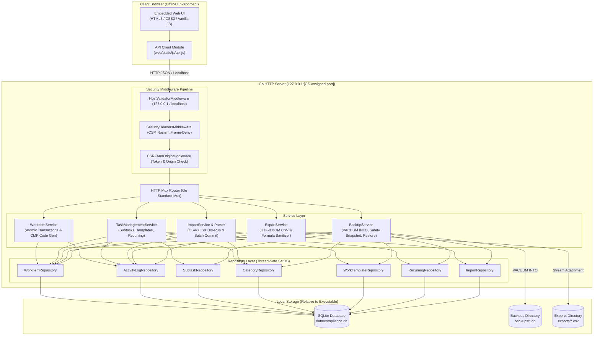

# Arsitektur Sistem Compliance Workspace v1.1.0

Dokumen ini mendokumentasikan arsitektur teknis, desain komponen, mekanisme komunikasi, alur data, serta spesifikasi antarmuka API dari aplikasi **Compliance Workspace v1.1.0**.

---

## 1. Ikhtisar & Prinsip Desain

Compliance Workspace v1.1.0 dibangun dengan pendekatan **Local-First, Offline-First, Portable, and Zero-Dependency**. Aplikasi ini dirancang untuk berjalan sebagai executable mandiri pada perangkat pengguna (Windows x64) tanpa memerlukan server web eksternal, runtime terpisah (tanpa Python/Node.js), koneksi internet, maupun database engine mandiri.

### Prinsip Utama
1. **Single Portable Binary**: Seluruh kode backend Go, driver database SQLite murni, dan aset frontend (HTML, CSS, Vanilla JS, ikon, gambar) dikemas dalam satu biner executable (`ComplianceWorkspace.exe`).
2. **Offline by Default**: Berjalan sepenuhnya pada alamat loopback `127.0.0.1` pada port acak yang dialokasikan oleh OS. Bebas dari CDN, cloud hosting, font daring, maupun pelacakan eksternal.
3. **Executable-Relative Paths**: Seluruh penyimpanan (`data/`, `backups/`, `exports/`) diresolusi relatif terhadap lokasi biner fisik executable (`os.Executable()`), bukan working directory atau user profile.
4. **Append-Only Auditability**: Setiap mutasi pekerjaan (*work item*) menghasilkan jejak riwayat aktivitas secara atomik di dalam satu transaksi database SQLite yang dilindungi trigger `ABORT`.
5. **Robust Local Security**: Perlindungan dari Host header spoofing, Origin/Referer check, token CSRF, Content Security Policy (CSP), serta sanitasi injeksi formula spreadsheet (CSV Formula Injection).
6. **Thread-Safe Hot Restore**: Kemampuan memulihkan basis data secara instan saat aplikasi berjalan (*runtime restore*) dengan penyegaran pool koneksi database secara atomik tanpa mematikan server.

---

## 2. Diagram Arsitektur Tingkat Tinggi



---

## 3. Struktur Proyek & Tanggung Jawab Komponen

```text
ComplianceWorkspace/
├── cmd/
│   └── compliance-workspace/
│       └── main.go                 # Titik masuk aplikasi, flag parsing, wiring dependency, graceful shutdown
├── internal/
│   ├── config/
│   │   └── config.go               # Resolusi path executable, validasi hak tulis direktori (write-probe)
│   ├── database/
│   │   ├── db.go                   # Pembukaan koneksi SQLite, PRAGMA setup, migration runner
│   │   └── migrations/             # Berkas DDL SQL migrasi skema 001 hingga 006
│   ├── domain/
│   │   ├── models.go               # Entitas domain (WorkItem, ActivityLog, Subtask, Category, Template, Recurring)
│   │   └── import_models.go        # Model batch impor, status validasi baris, dan pemetaan kolom
│   ├── repository/
│   │   ├── work_item_repo.go       # Operasi SQL tabel work_items, filter pencarian, dan tombstone
│   │   ├── activity_log_repo.go    # Operasi SQL tabel activity_logs (penyisipan append-only)
│   │   ├── subtask_repo.go         # Operasi CRUD butir checklist per pekerjaan
│   │   ├── category_repo.go        # Operasi master kategori dan proteksi referensi
│   │   ├── template_repo.go        # Penyimpanan dan pembacaan template pekerjaan
│   │   ├── recurring_repo.go       # Manajemen jadwal berulang dan pelacakan next_run_date
│   │   └── import_repo.go          # Pencatatan batch impor dan audit log baris impor
│   ├── server/
│   │   ├── server.go               # Registrasi endpoint REST API, static asset handler, lifecycle server
│   │   ├── middleware.go           # Pipeline keamanan (Host, CSRF, Origin, CSP, X-Frame-Options)
│   │   ├── task_mgmt_handlers.go   # HTTP handler untuk subtask, kategori, template, dan recurring
│   │   └── import_handlers.go      # HTTP handler untuk upload, preview, commit, rollback, dan template
│   └── service/
│       ├── work_item_service.go    # Logika bisnis penugasan, kode CMP atomik, pengarsipan, dan safe delete
│       ├── task_management_service.go # Kalkulasi progres, eksekusi recurring, dan penerapan template
│       ├── import_service.go       # Orkestrasi transaksi batch impor, deteksi duplikasi, dan kompensasi
│       ├── import_parser.go        # Parser CSV dan Excel (XLSX) dengan proteksi Zip Bomb & formula injection
│       ├── backup_service.go       # Backup VACUUM INTO, safety snapshot, rotasi, dan runtime restore
│       └── export_service.go       # Ekspor laporan CSV ber-BOM dengan sanitasi formula
├── web/
│   ├── embed.go                    # Go embed.FS untuk seluruh folder web/static
│   └── static/
│       ├── index.html              # Single Page Application antarmuka pengguna
│       ├── css/app.css             # Desain antarmuka responsif (light/dark mode ready)
│       ├── js/app.js               # State management, modal rendering, dan event handling
│       └── js/api.js               # Client API berbasis fetch async dengan proteksi CSRF
├── assets/
│   └── branding/
│       └── ComplianceWorkspace_app.ico # Ikon resmi resolusi multi-tier (16x16 s/d 256x256)
├── docs/                           # Dokumentasi teknis (ARCHITECTURE, DATABASE, BUILDING, TESTING)
├── scripts/                        # Skrip automasi PowerShell untuk build, packaging, dan smoke test
└── tests/                          # 22 suite pengujian otomatis (unit, integrasi, regresi)
```

---

## 4. Spesifikasi Kontrak REST API

Seluruh endpoint API mengembalikan respons JSON dan mewajibkan header keamanan `X-CSRF-Token` serta validasi `Origin` untuk seluruh metode mutasi (`POST`, `PUT`, `DELETE`).

### A. Autentikasi Sesi & Keamanan
- `GET /api/csrf-token` — Mendapatkan token CSRF unik untuk sesi peramban aktif.

### B. Manajemen Pekerjaan (Work Items)
- `POST /api/work-items` — Membuat pekerjaan kepatuhan baru dengan penomoran unik `CMP-YYYY-NNNNNN`.
- `GET /api/work-items` — Mengambil daftar pekerjaan dengan filter teks, kategori, status, prioritas, deadline, dan pengarsipan (`include_archived=true`).
- `GET /api/work-items/{id}` — Mengambil rincian lengkap pekerjaan beserta subtask dan riwayat log.
- `PUT /api/work-items/{id}` — Memperbarui data pekerjaan dan mencatat perubahan ke Activity Log.
- `POST /api/work-items/{id}/archive` — Mengarsipkan pekerjaan (*soft-delete*).
- `POST /api/work-items/{id}/restore` — Memulihkan pekerjaan dari arsip.
- `GET /api/work-items/{id}/delete-preview` — Mengambil pratinjau dampak penghapusan pekerjaan terarsip.
- `DELETE /api/work-items/{id}` — Menghapus pekerjaan secara operasional menggunakan penanda *tombstone* (`deleted_at`), menghapus subtask, dan mencatat log audit permanen.

### C. Subtask & Checklist
- `GET /api/work-items/{id}/subtasks` — Mengambil seluruh butir checklist pada pekerjaan.
- `POST /api/work-items/{id}/subtasks` — Menambahkan butir checklist baru dan menghitung ulang progres pekerjaan.
- `PUT /api/subtasks/{id}` — Mengubah judul, tenggat, atau status centang checklist.
- `DELETE /api/subtasks/{id}` — Menghapus butir checklist dan memperbarui progres pekerjaan.

### D. Master Kategori
- `GET /api/categories` — Mengambil daftar master kategori aktif dan default.
- `POST /api/categories` — Menambahkan kategori baru dengan warna visual.
- `PUT /api/categories/{id}` — Memperbarui nama, deskripsi, atau warna kategori.
- `DELETE /api/categories/{id}` — Menonaktifkan atau menghapus kategori jika tidak digunakan oleh pekerjaan aktif.

### E. Template & Recurring Tasks
- `GET /api/templates` & `POST /api/templates` — Mengelola cetak biru penugasan kepatuhan.
- `POST /api/templates/{id}/apply` — Menerapkan template ke form pekerjaan baru.
- `GET /api/recurring-schedules` & `POST /api/recurring-schedules` — Mengelola jadwal tugas berkala.
- `POST /api/recurring-schedules/trigger` — Mengevaluasi dan menghasilkan pekerjaan baru dari jadwal berulang secara instan (*idempotent*).

### F. Data Import Center
- `POST /api/import/preview` — Mengunggah berkas CSV/XLSX dan melakukan dry-run validasi read-only.
- `POST /api/import/commit` — Mengeksekusi komit batch impor secara atomik dengan snapshot keselamatan.
- `GET /api/import/history` — Mengambil daftar riwayat batch impor.
- `GET /api/import/batches/{id}` — Melihat detail hasil validasi baris per baris.
- `POST /api/import/batches/{id}/compensate` — Membatalkan batch impor dengan mengarsipkan pekerjaan terkait.
- `GET /api/import/batches/{id}/error-report` — Mengunduh file CSV laporan baris gagal/dilewati.
- `GET /api/import/template/csv` & `GET /api/import/template/xlsx` — Mengunduh file template standar.

### G. Pencadangan (Backup) & Pemulihan (Restore)
- `GET /api/backups` — Mengambil daftar berkas cadangan di folder `backups/`.
- `POST /api/backups` — Membuat snapshot SQLite `VACUUM INTO` baru.
- `POST /api/backups/restore` — Memulihkan database dari berkas cadangan dengan safety snapshot otomatis.
- `GET /api/backups/inspect` — Menginspeksi integritas SQLite dan versi skema berkas cadangan.
- `DELETE /api/backups/{filename}` — Menghapus berkas cadangan tertentu (menolak jika hanya tersisa 1 cadangan valid).
- `POST /api/backups/delete-batch` — Menghapus sejumlah berkas cadangan sekaligus.

### H. Ekspor Data
- `GET /api/export/work-items` — Mengunduh seluruh pekerjaan aktif dalam format CSV ber-BOM UTF-8.
- `GET /api/export/activity-logs` — Mengunduh seluruh jejak audit dalam format CSV ber-BOM UTF-8.

---

## 5. Pertimbangan Keamanan & Ketahanan Data

1. **Loopback Binding Strictness**: Server HTTP hanya mengikat ke `127.0.0.1` pada port bebas yang ditentukan oleh sistem operasi (`127.0.0.1:0`). Pengikatan ke `0.0.0.0` dilarang keras untuk mencegah akses dari jaringan lokal.
2. **Perlindungan DNS Rebinding & Host Validation**: Middleware memverifikasi kecocokan header `Host` terhadap `127.0.0.1:[port]` dan `localhost:[port]`.
3. **Penyelarasan Zona Waktu**: Seluruh penanda waktu kejadian disimpan dalam format standar UTC RFC3339 di database, dan diformat ke zona waktu lokal pengguna (`Asia/Jakarta`) saat disajikan di antarmuka web.
4. **Proteksi CSV Formula Injection**: Karakter berisiko seperti `=`, `+`, `-`, `@`, tab (`\t`), dan newline (`\r`) pada seluruh data string disanitasi secara otomatis sebelum diekspor ke berkas CSV demi mencegah eksekusi formula berbahaya pada Microsoft Excel.
