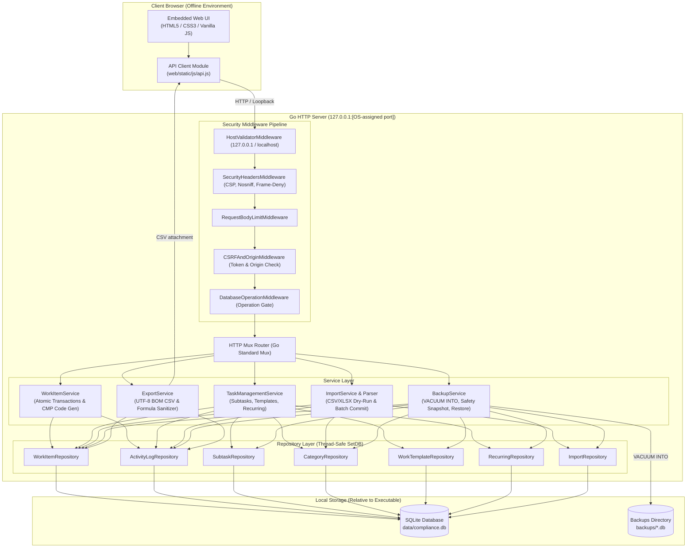

# Arsitektur Sistem Compliance Workspace v1.1.1

Dokumen ini mendokumentasikan arsitektur teknis, desain komponen, mekanisme komunikasi, alur data, serta spesifikasi antarmuka API dari aplikasi **Compliance Workspace v1.1.1**.

> **Patch v1.1.1 (Unreleased):** arsitektur utama dan schema v6 tetap dipertahankan. Patch menambahkan restore berbasis staging/atomic rename, koneksi inspeksi SQLite read-only, koordinasi operasi database saat restore, exact Host/Origin validation, request limits, dan HTTP timeouts.

---

## 1. Ikhtisar & Prinsip Desain

Compliance Workspace v1.1.1 dibangun dengan pendekatan **Local-First, Offline-First, Portable, and Zero-Dependency at Runtime**. Aplikasi ini dirancang untuk berjalan sebagai executable mandiri pada perangkat pengguna (Windows x64) tanpa memerlukan server web eksternal, runtime terpisah (tanpa Python/Node.js), koneksi internet, maupun database engine mandiri.

### Prinsip Utama
1. **Single Portable Binary**: Seluruh kode backend Go, driver database SQLite murni, dan aset frontend (HTML, CSS, Vanilla JS, ikon, gambar) dikemas dalam satu biner executable (`ComplianceWorkspace.exe`).
2. **Offline by Default**: Berjalan sepenuhnya pada alamat loopback `127.0.0.1` pada port acak yang dialokasikan oleh OS. Bebas dari CDN, cloud hosting, font daring, maupun pelacakan eksternal.
3. **Executable-Relative Paths**: Database aktif pada `data/` dan cadangan pada `backups/` diresolusi relatif terhadap lokasi biner fisik executable (`os.Executable()`), bukan working directory atau user profile. Folder `exports/` disediakan dalam paket, sedangkan hasil ekspor dikirim sebagai unduhan HTTP ke lokasi yang dipilih peramban.
4. **Append-Only Auditability**: Setiap mutasi pekerjaan (*work item*) menghasilkan jejak riwayat aktivitas secara atomik di dalam satu transaksi database SQLite yang dilindungi trigger `ABORT`.
5. **Robust Local Security**: Perlindungan dari Host header spoofing, Origin/Referer check, token CSRF, Content Security Policy (CSP), serta sanitasi injeksi formula spreadsheet (CSV Formula Injection).
6. **Thread-Safe Hot Restore**: Cadangan disalin ke staging dan diverifikasi sebelum aktivasi. Safety snapshot wajib berhasil; file aktif lama dipertahankan sebagai rollback sampai database pengganti lolos integrity/foreign-key check dan seluruh pool koneksi diperbarui.

---

## 2. Diagram Arsitektur Tingkat Tinggi



---

## 3. Struktur Proyek & Tanggung Jawab Komponen

```text
ComplianceWorkspace/
├── cmd/
│   └── compliance-workspace/
│       └── main.go                 # Titik masuk aplikasi, flag parsing, wiring dependency, graceful shutdown
├── internal/
│   ├── config/
│   │   └── config.go               # Resolusi path executable, validasi hak tulis direktori (write-probe)
│   ├── database/
│   │   ├── db.go                   # Pembukaan koneksi SQLite, PRAGMA setup, migration runner
│   │   ├── recovery.go             # Validasi struktur database dan pemulihan restore terinterupsi
│   │   └── migrations/             # Berkas DDL SQL migrasi skema 001 hingga 006
│   ├── domain/
│   │   ├── models.go               # Entitas domain (WorkItem, ActivityLog, Subtask, Category, Template, Recurring)
│   │   └── import_models.go        # Model batch impor, status validasi baris, dan pemetaan kolom
│   ├── repository/
│   │   ├── work_item_repo.go       # Operasi SQL tabel work_items, filter pencarian, dan tombstone
│   │   ├── activity_log_repo.go    # Operasi SQL tabel activity_logs (penyisipan append-only)
│   │   ├── subtask_repo.go         # Operasi CRUD butir checklist per pekerjaan
│   │   ├── category_repo.go        # Operasi master kategori dan proteksi referensi
│   │   ├── template_repo.go        # Penyimpanan dan pembacaan template pekerjaan
│   │   ├── recurring_repo.go       # Manajemen jadwal berulang dan pelacakan next_run_date
│   │   └── import_repo.go          # Pencatatan batch impor dan audit log baris impor
│   ├── server/
│   │   ├── server.go               # Registrasi endpoint REST API, static asset handler, lifecycle server
│   │   ├── middleware.go           # Pipeline keamanan (Host, CSRF, Origin, CSP, X-Frame-Options)
│   │   ├── task_mgmt_handlers.go   # HTTP handler untuk subtask, kategori, template, dan recurring
│   │   └── import_handlers.go      # HTTP handler untuk upload, preview, commit, rollback, dan template
│   └── service/
│       ├── work_item_service.go    # Logika bisnis penugasan, kode CMP atomik, pengarsipan, dan safe delete
│       ├── task_management_service.go # Kalkulasi progres, eksekusi recurring, dan penerapan template
│       ├── import_service.go       # Orkestrasi transaksi batch impor, deteksi duplikasi, dan kompensasi
│       ├── import_parser.go        # Parser CSV dan Excel (XLSX) dengan proteksi Zip Bomb & formula injection
│       ├── backup_service.go       # Backup VACUUM INTO, safety snapshot, rotasi, dan runtime restore
│       └── export_service.go       # Ekspor laporan CSV ber-BOM dengan sanitasi formula
├── web/
│   ├── embed.go                    # Go embed.FS untuk seluruh folder web/static
│   └── static/
│       ├── index.html              # Single Page Application antarmuka pengguna
│       ├── css/app.css             # Desain antarmuka responsif (light/dark mode ready)
│       ├── js/app.js               # State management, modal rendering, dan event handling
│       └── js/api.js               # Client API berbasis fetch async dengan proteksi CSRF
├── assets/
│   └── branding/
│       └── ComplianceWorkspace_app.ico # Ikon resmi resolusi multi-tier (16x16 s/d 256x256)
├── docs/                           # Dokumentasi teknis (ARCHITECTURE, DATABASE, BUILDING, TESTING)
├── scripts/                        # Skrip automasi PowerShell untuk build, packaging, dan smoke test
└── tests/                          # Pengujian otomatis lintas modul (unit, integrasi, regresi)
```

---

## 4. Lifecycle Aplikasi dan Koordinasi Database

1. **Startup**: Konfigurasi menyelesaikan jalur `data/compliance.db` dan `backups/` relatif terhadap executable serta memeriksa hak tulis. `database.RecoverInterruptedRestore()` dijalankan sebelum `database.OpenDB()` dan migrasi. Active database yang kosong, korup, atau tidak sesuai struktur ditolak; first run hanya dilanjutkan jika database dan artefak recovery memang belum ada.
2. **Inisialisasi layanan**: Setelah migrasi 001–006 selesai, repository dan service dibentuk dengan pool database yang sama. Jadwal berulang dievaluasi sekali saat startup.
3. **Background recurring**: Ticker setiap satu jam memanggil evaluasi jadwal dengan konteks berbatas waktu. `TaskManagementService` memegang satu read lock pada operation gate untuk request recurring maupun ticker.
4. **Operation gate**: Request database biasa memegang read lock di middleware. Endpoint restore melewati read lock middleware dan `BackupService` memegang exclusive lock selama prosedur restore. Endpoint recurring juga melewati lock middleware karena service mengambil read lock sendiri. Pemisahan ini mencegah recursive `RWMutex.RLock` ketika restore sedang menunggu writer lock.
5. **Restore runtime**: Kandidat disalin ke staging, divalidasi, dimigrasikan, dan divalidasi ulang. Setelah safety snapshot berhasil, active database dipindahkan ke rollback dan staging diaktifkan dengan rename pada filesystem yang sama. Pool repository/service baru dipasang hanya setelah kandidat aktif lolos pemeriksaan.
6. **Interrupted restore recovery**: Pada startup berikutnya, active database valid tidak ditimpa rollback lama. Jika active database tidak ada, tepat satu rollback yang aman dan valid dapat dipulihkan; staging tanpa rollback, artefak ambigu, direktori/reparse point, atau kandidat tidak valid menyebabkan startup gagal sebelum `OpenDB()`. Artefak staging dan safety backup tidak dihapus otomatis.
7. **Shutdown**: Proses menangani `Ctrl+C`/`SIGTERM`, menghentikan ticker, memberi server HTTP waktu lima detik untuk shutdown, lalu menutup koneksi database. Penutupan jendela secara paksa tidak setara dengan shutdown berbasis sinyal.

---

## 5. Spesifikasi Kontrak REST API

Sebagian besar endpoint API mengembalikan JSON; endpoint ekspor, template impor, laporan kesalahan, dan aset statis mengirim berkas atau konten sesuai tipenya. Metode mutasi (`POST`, `PUT`, `DELETE`) mewajibkan header `X-CSRF-Token` yang cocok dengan cookie sesi. Jika dikirim oleh klien, `Origin` atau fallback `Referer` harus cocok persis dengan authority loopback dan port listener.

### A. Autentikasi Sesi & Keamanan
- `GET /api/csrf-token` — Mendapatkan token CSRF unik untuk sesi peramban aktif.

### B. Manajemen Pekerjaan (Work Items)
- `POST /api/work-items` — Membuat pekerjaan kepatuhan baru dengan penomoran unik `CMP-YYYY-NNNNNN`.
- `GET /api/work-items` — Mengambil daftar pekerjaan dengan pencarian teks, filter kategori/status/prioritas/provenance, opsi arsip (`include_archived=true`), dan pengurutan.
- `GET /api/work-items/{id}` — Mengambil satu pekerjaan berdasarkan ID.
- `PUT /api/work-items/{id}` — Memperbarui data pekerjaan dan mencatat perubahan ke Activity Log.
- `GET /api/work-items/{id}/activities` — Mengambil riwayat aktivitas pekerjaan.
- `POST /api/work-items/{id}/activities` — Menambahkan catatan aktivitas append-only.
- `POST /api/work-items/{id}/archive` — Mengarsipkan pekerjaan (*soft-delete*).
- `POST /api/work-items/{id}/restore` — Memulihkan pekerjaan dari arsip.
- `GET /api/work-items/{id}/delete-preview` — Mengambil pratinjau dampak penghapusan pekerjaan terarsip.
- `DELETE /api/work-items/{id}` — Menghapus pekerjaan secara operasional menggunakan penanda *tombstone* (`deleted_at`), menghapus subtask, dan mencatat log audit permanen.

### C. Subtask & Checklist
- `GET /api/work-items/{id}/subtasks` — Mengambil seluruh butir checklist pada pekerjaan.
- `POST /api/work-items/{id}/subtasks` — Menambahkan butir checklist baru dan menghitung ulang progres pekerjaan.
- `PUT /api/subtasks/{id}` — Mengubah judul, tenggat, atau status centang checklist.
- `DELETE /api/subtasks/{id}` — Menghapus butir checklist dan memperbarui progres pekerjaan.

### D. Master Kategori
- `GET /api/categories` — Mengambil daftar master kategori aktif dan default.
- `POST /api/categories` — Menambahkan kategori baru dengan warna visual.
- `PUT /api/categories/{id}` — Memperbarui nama, deskripsi, atau warna kategori.
- `DELETE /api/categories/{id}` — Menghapus kategori nondefault jika tidak direferensikan oleh pekerjaan, template, atau jadwal; status aktif/nonaktif diubah melalui `PUT`.

### E. Template & Recurring Tasks
- `GET|POST /api/templates` dan `GET|PUT|DELETE /api/templates/{id}` — Membaca dan mengelola cetak biru penugasan kepatuhan.
- `POST /api/templates/{id}/apply` — Membuat pekerjaan dan checklist secara atomik dari template dengan kustomisasi input opsional.
- `GET|POST /api/recurring-schedules` dan `PUT|DELETE /api/recurring-schedules/{id}` — Mengelola jadwal tugas berkala.
- `POST /api/recurring-schedules/trigger` — Mengevaluasi dan menghasilkan pekerjaan baru dari jadwal berulang secara instan (*idempotent*).

### F. Data Import Center
- `POST /api/import/preview` — Mengunggah berkas CSV/XLSX dan melakukan dry-run validasi read-only.
- `POST /api/import/commit` — Mengeksekusi komit batch impor secara atomik dengan snapshot keselamatan.
- `GET /api/import/history` — Mengambil daftar riwayat batch impor.
- `GET /api/import/batches/{id}` — Melihat detail hasil validasi baris per baris.
- `POST /api/import/batches/{id}/compensate` — Membatalkan batch impor dengan mengarsipkan pekerjaan terkait.
- `GET /api/import/batches/{id}/error-report` — Mengunduh file CSV laporan baris gagal/dilewati.
- `GET /api/import/template/csv` & `GET /api/import/template/xlsx` — Mengunduh file template standar.

### G. Pencadangan (Backup) & Pemulihan (Restore)
- `GET /api/backups` — Mengambil daftar berkas cadangan di folder `backups/`.
- `POST /api/backups` — Membuat snapshot SQLite `VACUUM INTO` baru.
- `POST /api/backups/restore` — Memulihkan database dari berkas cadangan dengan safety snapshot otomatis.
- `GET /api/backups/inspect` — Menginspeksi integritas SQLite dan versi skema berkas cadangan.
- `DELETE /api/backups/{filename}` — Menghapus berkas cadangan tertentu (menolak jika hanya tersisa 1 cadangan valid).
- `POST /api/backups/delete-batch` — Menghapus sejumlah berkas cadangan sekaligus.

### H. Ekspor Data
- `GET /api/export/work-items` — Mengunduh seluruh pekerjaan aktif dalam format CSV ber-BOM UTF-8.
- `GET /api/export/activity-logs` — Mengunduh seluruh jejak audit dalam format CSV ber-BOM UTF-8.

---

## 6. Pertimbangan Keamanan & Ketahanan Data

1. **Loopback Binding Strictness**: Server HTTP hanya mengikat ke `127.0.0.1` pada port bebas yang ditentukan oleh sistem operasi (`127.0.0.1:0`). Pengikatan ke `0.0.0.0` dilarang keras untuk mencegah akses dari jaringan lokal.
2. **Perlindungan DNS Rebinding & Host Validation**: Middleware memverifikasi kecocokan persis header `Host` terhadap `127.0.0.1:[port]` atau `localhost:[port]` dengan port listener yang aktif.
3. **Penyelarasan Zona Waktu**: Seluruh penanda waktu kejadian disimpan dalam format standar UTC RFC3339 di database, dan diformat ke zona waktu lokal pengguna (`Asia/Jakarta`) saat disajikan di antarmuka web.
4. **Proteksi CSV Formula Injection**: Nilai teks yang diawali `=`, `+`, `-`, `@`, tab (`\t`), atau carriage return (`\r`) diberi prefiks aman sebelum diekspor ke CSV untuk mengurangi risiko interpretasi sebagai formula spreadsheet.
5. **Batas HTTP Eksplisit**: Server menetapkan read-header/read/write/idle timeout, batas header, batas JSON 1 MiB, serta batas request impor 11 MiB (file maksimum 10 MiB ditambah overhead multipart).
6. **CSRF dan Source Validation**: Cookie token acak 32-byte bersifat `HttpOnly` dan `SameSite=Strict`; request mutasi harus mengirim token yang sama melalui `X-CSRF-Token`. Origin/Referer nonlokal ditolak, tetapi kontrol ini bukan pengganti autentikasi jaringan.
7. **CSP & DOM Safety**: CSP membatasi skrip, koneksi, objek, frame, dan form ke kebijakan lokal. Data tidak tepercaya pada jalur UI yang diaudit dirender sebagai teks atau di-escape sebelum masuk ke HTML.
8. **Batas Arsitektur**: Aplikasi adalah workspace personal tanpa autentikasi pengguna atau enkripsi database bawaan. Keamanan file tetap bergantung pada kontrol akun dan filesystem sistem operasi; server tidak boleh dipublikasikan ke LAN atau internet.
