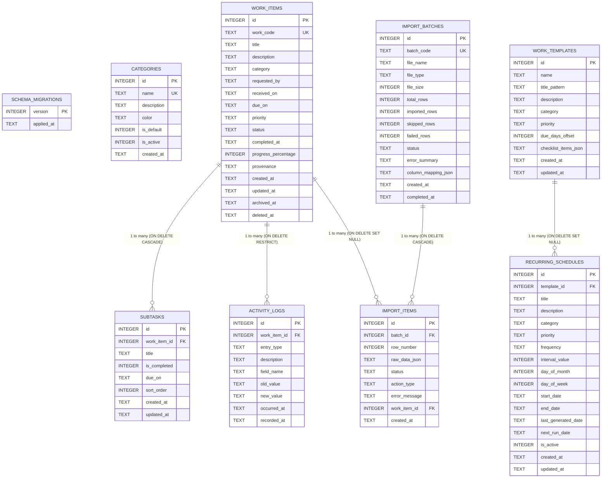

# Dokumentasi Basis Data Compliance Workspace v1.1.1

Dokumen ini menjelaskan struktur skema basis data SQLite, relasi antar-entitas, mekanisme migrasi skema inkremental (001–006), integritas transaksi, arsitektur audit log *append-only*, pola tombstone penghapusan aman, serta prosedur pencadangan (*backup*) dan pemulihan (*restore*).

---

## 1. Konfigurasi Mesin & PRAGMA SQLite

Aplikasi menggunakan driver SQLite murni dalam bahasa Go (`modernc.org/sqlite`) yang dikonfigurasi melalui `internal/database/db.go` dengan parameter khusus untuk portabilitas dan konsistensi data:

```go
dsn := fmt.Sprintf("%s?_pragma=foreign_keys(ON)&_pragma=journal_mode(DELETE)&_pragma=busy_timeout(5000)", dbPath)
db, err := sql.Open("sqlite", dsn)
db.SetMaxOpenConns(1)
```

### Parameter Operasional:
- **`PRAGMA foreign_keys = ON;`**  
  Menegakkan integritas referensial antar-tabel secara ketat. Hubungan induk-anak divalidasi pada setiap operasi database (`ON DELETE RESTRICT`, `ON DELETE CASCADE`, atau `ON DELETE SET NULL`).
- **`PRAGMA journal_mode = DELETE;`**  
  Menggunakan model *rollback journal* portabel. Setelah transaksi selesai, file `-journal` dihapus sehingga direktori penyimpanan hanya menyisakan satu berkas database tunggal (`compliance.db`), memudahkan pemindahan dan penyalinan folder aplikasi saat dimatikan.
- **`PRAGMA busy_timeout = 5000;`**  
  Menetapkan batas waktu tunggu toleransi penguncian hingga 5000 milidetik (5 detik) untuk mencegah kegagalan instan saat terjadi antrean akses penulisan.
- **`db.SetMaxOpenConns(1);`**  
  Membatasi koneksi database aktif menjadi 1 koneksi tunggal (*single connection pool*). Ini adalah praktik terbaik pada SQLite lokal di sistem operasi Windows guna menghindari persaingan kunci berkas (*file-locking contention*) antar-goroutine.

---

## 2. Diagram Relasi Entitas (Entity-Relationship Diagram)



---

## 3. Rincian Migrasi Skema (001–006)

Sistem migrasi database dikelola secara inkremental melalui berkas SQL terurut pada folder `internal/database/migrations/`:

| Versi | Nama Berkas | Tujuan & Cakupan Perubahan |
| :---: | :--- | :--- |
| **001** | `001_initial_schema.sql` | Skema baseline v1.0.0: tabel `schema_migrations`, `work_items`, `activity_logs`, indeks utama, serta trigger proteksi `activity_logs_no_update` dan `activity_logs_no_delete`. |
| **002** | `002_v1_1_schema.sql` | Penambahan tabel `categories` (dengan seed 5 kategori standar), `subtasks`, `work_templates`, `recurring_schedules`, `import_batches`, `import_items`, dan penambahan kolom `progress_percentage` pada `work_items`. |
| **003** | `003_v1_1_refinements.sql` | Penambahan unique partial index `uq_work_items_recurring_period` untuk mencegah pekerjaan ganda dari jadwal dan periode target yang sama. |
| **004** | `004_category_is_active.sql` | Penambahan kolom `is_active` (0/1) pada tabel `categories` untuk mendukung deaktivasi kategori tanpa merusak relasi historis. |
| **005** | `005_work_item_provenance.sql` | Penambahan kolom `provenance` (`manual`, `template`, `recurring`, `import`, `unknown`) pada `work_items` serta backfill otomatis data historis berbasis log aktivitas. |
| **006** | `006_work_item_deletion_tombstone.sql` | Penambahan kolom `deleted_at` dan indeks `idx_work_items_deleted` pada tabel `work_items` untuk mendukung mekanisme *audit-compliant permanent delete*. |

---

## 4. Rincian Skema Tabel Utama

### A. Tabel `work_items`
Menyimpan data master penugasan / pekerjaan compliance.

| Kolom | Tipe | Batasan | Keterangan |
| :--- | :--- | :--- | :--- |
| `id` | `INTEGER` | `PRIMARY KEY AUTOINCREMENT` | ID unik internal sistem. |
| `work_code` | `TEXT` | `UNIQUE` | Kode unik bisnis berformat `CMP-YYYY-NNNNNN` (immutable). |
| `title` | `TEXT` | `NOT NULL CHECK (length(trim(title)) > 0)` | Judul tugas (wajib diisi, tidak boleh spasi kosong). |
| `description` | `TEXT` | `NOT NULL DEFAULT ''` | Deskripsi rincian penugasan. |
| `category` | `TEXT` | `NOT NULL DEFAULT 'General'` | Nama kategori penugasan. |
| `requested_by`| `TEXT` | Nullable | Nama pihak atau divisi yang memberikan tugas. |
| `received_on` | `TEXT` | `NOT NULL` | Tanggal tugas diterima berformat `YYYY-MM-DD`. |
| `due_on` | `TEXT` | Nullable | Tanggal batas waktu penyelesaian `YYYY-MM-DD`. |
| `priority` | `TEXT` | `NOT NULL DEFAULT 'normal' CHECK (priority IN ('low','normal','high','critical'))` | Tingkat urgensi penugasan. |
| `status` | `TEXT` | `NOT NULL DEFAULT 'not_started' CHECK (status IN ('not_started','in_progress','waiting','completed','cancelled'))` | Status alur kerja pekerjaan. |
| `completed_at`| `TEXT` | Nullable | Timestamp UTC RFC3339 saat status menjadi `completed`. |
| `progress_percentage` | `INTEGER` | `NOT NULL DEFAULT 0 CHECK (progress_percentage >= 0 AND progress_percentage <= 100)` | Persentase progres pekerjaan (0 - 100%). |
| `provenance` | `TEXT` | `NOT NULL DEFAULT 'unknown' CHECK (provenance IN ('manual','template','recurring','import','unknown'))` | Asal pembentukan pekerjaan. |
| `created_at` | `TEXT` | `NOT NULL DEFAULT (strftime('%Y-%m-%dT%H:%M:%fZ','now'))` | Timestamp UTC saat rekaman dibuat. |
| `updated_at` | `TEXT` | `NOT NULL DEFAULT (strftime('%Y-%m-%dT%H:%M:%fZ','now'))` | Timestamp UTC saat rekaman terakhir diubah. |
| `archived_at`| `TEXT` | Nullable | Timestamp UTC saat pekerjaan diarsipkan (*soft delete*). |
| `deleted_at` | `TEXT` | Nullable | Timestamp UTC saat pekerjaan dihapus permanen secara operasional (*tombstone*). |

### B. Tabel `activity_logs` (Jejak Audit Append-Only)
Menyimpan riwayat seluruh aksi dan perubahan data penugasan compliance secara kronologis.

| Kolom | Tipe | Batasan | Keterangan |
| :--- | :--- | :--- | :--- |
| `id` | `INTEGER` | `PRIMARY KEY AUTOINCREMENT` | ID unik log riwayat. |
| `work_item_id` | `INTEGER` | `NOT NULL REFERENCES work_items(id) ON DELETE RESTRICT` | Referensi ke pekerjaan terkait. |
| `entry_type` | `TEXT` | `NOT NULL CHECK (entry_type IN ('created','activity','edited','status_changed','archived','restored'))` | Tipe mutasi data. Penghapusan tombstone dicatat sebagai `activity` dengan deskripsi khusus. |
| `description` | `TEXT` | `NOT NULL CHECK (length(trim(description)) > 0)` | Uraian aktivitas dalam Bahasa Indonesia. |
| `field_name` | `TEXT` | Nullable | Nama atribut yang mengalami perubahan nilai. |
| `old_value` | `TEXT` | Nullable | Nilai sebelum perubahan. |
| `new_value` | `TEXT` | Nullable | Nilai setelah perubahan. |
| `occurred_at` | `TEXT` | `NOT NULL` | Waktu riil kejadian (UTC RFC3339). |
| `recorded_at` | `TEXT` | `NOT NULL DEFAULT (strftime('%Y-%m-%dT%H:%M:%fZ','now'))` | Waktu sistem saat rekaman disimpan (UTC RFC3339). |

### C. Tabel `categories`
Menyimpan daftar kategori klasifikasi pekerjaan.

| Kolom | Tipe | Batasan | Keterangan |
| :--- | :--- | :--- | :--- |
| `id` | `INTEGER` | `PRIMARY KEY AUTOINCREMENT` | ID unik kategori. |
| `name` | `TEXT` | `UNIQUE NOT NULL CHECK (length(trim(name)) > 0)` | Nama kategori unik. |
| `description` | `TEXT` | `NOT NULL DEFAULT ''` | Deskripsi kategori. |
| `color` | `TEXT` | `NOT NULL DEFAULT '#4f46e5'` | Kode warna hex tampilan visual di UI. |
| `is_default` | `INTEGER` | `NOT NULL DEFAULT 0 CHECK (is_default IN (0, 1))` | Penanda kategori bawaan sistem. |
| `is_active` | `INTEGER` | `NOT NULL DEFAULT 1 CHECK (is_active IN (0, 1))` | Status aktif/non-aktif kategori. |
| `created_at` | `TEXT` | `NOT NULL DEFAULT (strftime('%Y-%m-%dT%H:%M:%fZ','now'))` | Waktu pembuatan kategori. |

### D. Tabel `subtasks`
Menyimpan butir langkah kerja (checklist) per pekerjaan penugasan.

| Kolom | Tipe | Batasan | Keterangan |
| :--- | :--- | :--- | :--- |
| `id` | `INTEGER` | `PRIMARY KEY AUTOINCREMENT` | ID unik subtask. |
| `work_item_id` | `INTEGER` | `NOT NULL REFERENCES work_items(id) ON DELETE CASCADE` | ID penugasan induk. |
| `title` | `TEXT` | `NOT NULL CHECK (length(trim(title)) > 0)` | Uraian butir checklist. |
| `is_completed`| `INTEGER` | `NOT NULL DEFAULT 0 CHECK (is_completed IN (0, 1))` | Status checklist (0 = belum, 1 = selesai). |
| `due_on` | `TEXT` | Nullable | Tenggat waktu spesifik subtask (YYYY-MM-DD). |
| `sort_order` | `INTEGER` | `NOT NULL DEFAULT 0` | Urutan penomoran butir checklist. |
| `created_at` | `TEXT` | `NOT NULL DEFAULT (strftime('%Y-%m-%dT%H:%M:%fZ','now'))` | Waktu pembuatan subtask. |
| `updated_at` | `TEXT` | `NOT NULL DEFAULT (strftime('%Y-%m-%dT%H:%M:%fZ','now'))` | Waktu pembaruan status subtask. |

### E. Tabel `work_templates` & `recurring_schedules`
- **`work_templates`**: Menyimpan template pekerjaan kepatuhan dengan pola judul (`title_pattern`), checklist bawaan berformat JSON (`checklist_items_json`), kategori, dan durasi tenggat (`due_days_offset`).
- **`recurring_schedules`**: Menyimpan konfigurasi otomatisasi pembentukan tugas berkala berbasis frekuensi (`daily`, `weekly`, `monthly`, `quarterly`, `yearly`), tanggal evaluasi berikutnya (`next_run_date`), dan status aktif (`is_active`).

### F. Tabel `import_batches` & `import_items`
- **`import_batches`**: Mencatat metadata setiap sesi impor data spreadsheet (kode batch `IMP-YYYYMMDD-XXXXXX`, nama file, total baris, jumlah berhasil, dilewati, dan gagal, serta konfigurasi mapping JSON).
- **`import_items`**: Menyimpan rekaman mentah setiap baris data impor (`raw_data_json`), status dan tindakan baris (`action_type`), pesan kesalahan jika ditolak, serta ID pekerjaan yang berhasil dibentuk.

---

## 5. Arsitektur Penghapusan Aman & Jejak Audit (Tombstone Pattern)

Dalam lingkungan kepatuhan dan audit forensik, penghapusan baris data secara destruktif (*physical hard delete* / `DELETE FROM work_items`) dilarang keras karena dapat memutus mata rantai jejak audit.

Oleh karena itu, Compliance Workspace v1.1.0 menerapkan **Audit-Compliant Tombstone Pattern**:

1. **Penandaan Tombstone (`deleted_at`)**:
   Saat pengguna melakukan tindakan "Hapus Permanen", sistem tidak mengeksekusi `DELETE FROM work_items`, melainkan mengisi kolom `deleted_at = datetime('now')`.
2. **Pembersihan Subtask Operasional**:
   Seluruh subtask terkait pada tabel `subtasks` dihapus secara fisik untuk membersihkan beban kerja operasional aktif.
3. **Pencatatan Log Audit Permanen**:
   Sistem menyisipkan rekaman baru pada `activity_logs` dengan `entry_type = 'activity'` dan uraian penghapusan. Log ini dilindungi oleh trigger database `activity_logs_no_delete` dan `activity_logs_no_update`.
4. **Penyaringan Kueri Otomatis**:
   Seluruh kueri operasional (Daftar Pekerjaan, Dashboard, Deadline Tracker, Ekspor) menyertakan klausa `WHERE deleted_at IS NULL` sehingga pekerjaan yang telah dihapus tidak lagi muncul di antarmuka pengguna, namun riwayat penugasannya tetap dapat diaudit oleh auditor jika diperlukan.

---

## 6. Prosedur Pencadangan (Backup) & Pemulihan (Restore)

### A. Pencadangan Konsisten SQLite (`VACUUM INTO`)
Aplikasi tidak pernah menyalin berkas database aktif secara naif menggunakan fungsi salin file OS. Pencadangan dieksekusi melalui perintah resmi SQLite:

```sql
VACUUM INTO 'backups/compliance_backup_YYYYMMDD_HHMMSS_XXXXXXXX.db';
```

Perintah ini menghasilkan snapshot SQLite yang konsisten dan terkompaksi tanpa menyalin file database aktif secara langsung. Sebelum dipertahankan sebagai cadangan, hasilnya diperiksa melalui kontrak `database.ValidateDatabaseFile`; hasil yang gagal divalidasi ditolak dan dihapus.

### B. Kontrak Validasi Database Bersama

`database.ValidateDatabaseFile()` membuka kandidat secara read-only dan digunakan oleh startup recovery, inspeksi cadangan, pembuatan cadangan, serta restore. Pemeriksaannya mencakup:

- `PRAGMA integrity_check` dan `PRAGMA foreign_key_check`;
- keberadaan `schema_migrations`, versi maksimum 1–6, dan riwayat migrasi kontinu tanpa gap atau entri tambahan;
- tabel dan kolom inti untuk schema v1;
- tabel fitur serta `progress_percentage` untuk schema v2+;
- `categories.is_active` untuk v4+, `work_items.provenance` untuk v5+, dan `work_items.deleted_at` untuk v6+.

Database schema v1–v5 yang valid tetap dapat dipakai sebagai kandidat restore dan dimigrasikan pada staging. Nomor versi yang tampak valid tidak cukup apabila struktur aplikasi tidak sesuai.

### C. Pemulihan Runtime Tanpa Restart Aplikasi
Saat pemulihan (*restore*) dijalankan:
1. **Validasi Path & Sumber**: Nama file harus basename `.db`/`.sqlite`, file reguler, berada di dalam direktori backup, dan bukan symbolic link/reparse-point target.
2. **Inspeksi Read-Only**: Sumber diperiksa tanpa mode tulis menggunakan kontrak validasi bersama, lalu disalin ke staging pada filesystem yang sama.
3. **Migrasi dan Validasi Staging**: Backup schema v1–v5 dimigrasikan pada salinan staging, bukan pada file backup sumber atau database aktif. Staging divalidasi sebelum dan setelah migrasi.
4. **Safety Snapshot Wajib**: `VACUUM INTO pre_restore_safety_*.db` harus berhasil dan lolos validasi bersama. Restore dibatalkan sebelum koneksi aktif ditutup jika tahap ini gagal.
5. **Aktivasi Atomik & Rollback**: Setelah request/background operation berhenti pada gate, koneksi lama ditutup, `compliance.db` dipindahkan ke file rollback, dan staging diaktifkan dengan rename. File lama tidak dihapus sampai kandidat berhasil dibuka dan diverifikasi.
6. **Rollback Saat Aktivasi Gagal**: Jalur kegagalan kritis setelah penutupan koneksi atau aktivasi kandidat mencoba mengembalikan file asli, membuka ulang pool lama, dan memperbarui service. Jika operasi filesystem rollback itu sendiri gagal, aplikasi mengembalikan error dan artefak dipertahankan untuk recovery startup atau pemulihan manual; pemulihan sempurna tidak dijanjikan untuk setiap kegagalan media/filesystem.
7. **Operasi Berlanjut Tanpa Restart**: Setelah sukses, pool `WorkItemService`, `TaskManagementService`, dan `ImportService` menunjuk database baru dan browser dapat melanjutkan operasi.
8. **Startup Crash Recovery**: `database.RecoverInterruptedRestore()` selalu berjalan sebelum `database.OpenDB()`. Active database yang sudah ada harus berupa file reguler non-zero dan lolos validasi struktur; database valid tidak ditimpa rollback lama. Jika active database tidak ada, tepat satu rollback yang aman dan valid dapat dipulihkan. Rollback korup/ambigu, staging tanpa rollback, schema di atas v6, atau artefak berupa symlink, junction, reparse point, atau direktori menyebabkan startup gagal tertutup agar SQLite tidak membuat database kosong.
9. **Preservasi Artefak**: Staging sisa dan safety backup tidak dihapus otomatis oleh startup recovery. Setelah restore sukses, rollback sementara dihapus; safety snapshot tetap tersedia di `backups/`.

Database runtime berada pada `data/compliance.db` dan cadangan pada `backups/`, keduanya relatif terhadap direktori executable. Patch v1.1.1 tidak menambah migrasi; kompatibilitas validator tetap schema 1–6 dengan schema aktif v6.
