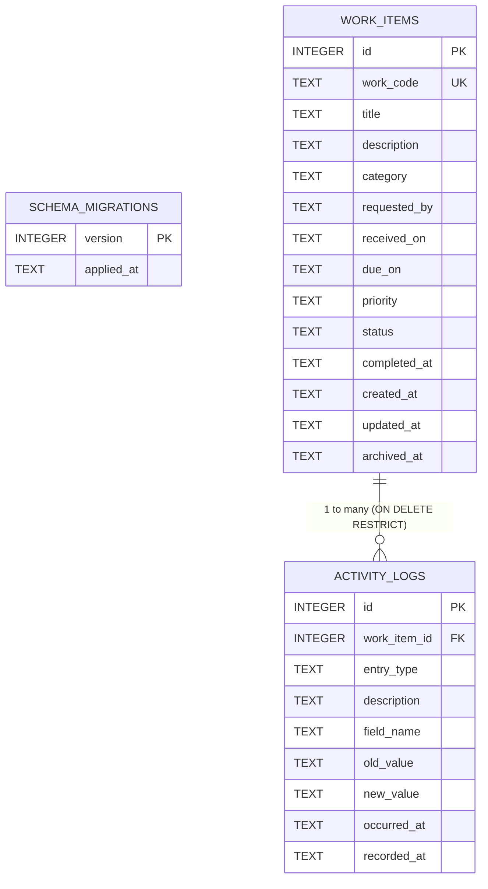
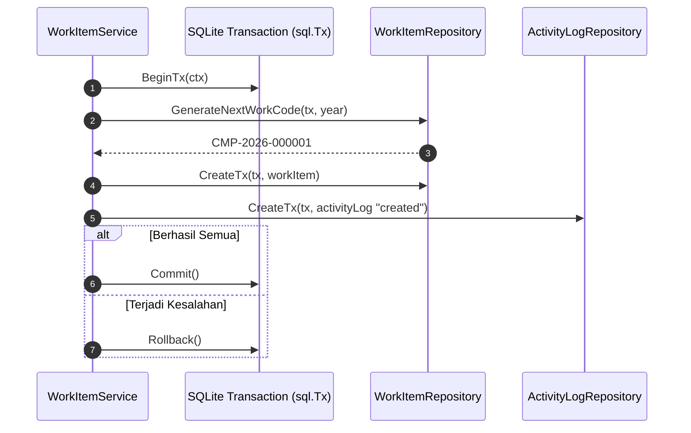
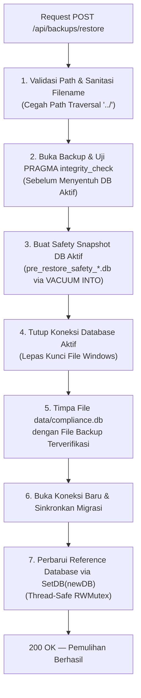

# Dokumentasi Basis Data Compliance Workspace v1.0

Dokumen ini menjelaskan struktur skema basis data SQLite, relasi antar-entitas, mekanisme migrasi, integritas transaksi, arsitektur audit log *append-only*, serta prosedur pencadangan (*backup*) dan pemulihan (*restore*).

---

## 1. Konfigurasi Mesin & PRAGMA SQLite

Aplikasi menggunakan driver SQLite murni dalam bahasa Go (`modernc.org/sqlite`) yang dikonfigurasi melalui [internal/database/db.go](file:///c:/Users/AXIOO%20HYPE%203%20G12/Documents/ComplianceWorkspace/internal/database/db.go) dengan parameter khusus untuk portabilitas dan konsistensi:

```go
dsn := fmt.Sprintf("%s?_pragma=foreign_keys(ON)&_pragma=journal_mode(DELETE)&_pragma=busy_timeout(5000)", dbPath)
db, err := sql.Open("sqlite", dsn)
db.SetMaxOpenConns(1)
```

### Parameter Operasional:
- **`PRAGMA foreign_keys = ON;`**  
  Menegakkan integritas referensial antar-tabel secara ketat. Penghapusan induk yang masih memiliki relasi anak akan ditolak (`ON DELETE RESTRICT`).
- **`PRAGMA journal_mode = DELETE;`**  
  Menggunakan model *rollback journal* portabel. Setelah transaksi selesai, file `-journal` dihapus sehingga direktori penyimpanan hanya menyisakan satu file database tunggal (`compliance.db`), memudahkan pemindahan dan penyalinan saat aplikasi dimatikan.
- **`PRAGMA busy_timeout = 5000;`**  
  Menetapkan batas waktu tunggu toleransi penguncian hingga 5000 milidetik (5 detik) untuk mencegah kegagalan instan saat terjadi antrean akses penulisan.
- **`db.SetMaxOpenConns(1);`**  
  Membatasi koneksi database aktif menjadi 1 koneksi tunggal (*single connection pool*). Ini adalah praktik terbaik pada SQLite lokal di sistem operasi Windows guna menghindari persaingan kunci file (*file-locking contention*) antar-goroutine.

---

## 2. Diagram Relasi Entitas (Entity-Relationship Diagram)



---

## 3. Rincian Skema Tabel

### A. Tabel `schema_migrations`
Menyimpan riwayat versi migrasi DDL yang telah berhasil diterapkan.

| Kolom | Tipe | Batasan | Keterangan |
| :--- | :--- | :--- | :--- |
| `version` | `INTEGER` | `PRIMARY KEY` | Nomor urut versi migrasi (misal `1`). |
| `applied_at` | `TEXT` | `NOT NULL DEFAULT (strftime('%Y-%m-%dT%H:%M:%fZ','now'))` | Timestamp UTC saat migrasi dijalankan. |

---

### B. Tabel `work_items`
Menyimpan data master penugasan / pekerjaan compliance.

| Kolom | Tipe | Batasan | Keterangan |
| :--- | :--- | :--- | :--- |
| `id` | `INTEGER` | `PRIMARY KEY AUTOINCREMENT` | ID unik internal sistem. |
| `work_code` | `TEXT` | `UNIQUE` | Kode unik bisnis berformat `CMP-YYYY-NNNNNN` (immutable). |
| `title` | `TEXT` | `NOT NULL CHECK (length(trim(title)) > 0)` | Judul tugas (wajib diisi, tidak boleh spasi kosong). |
| `description` | `TEXT` | `NOT NULL DEFAULT ''` | Deskripsi rincian penugasan. |
| `category` | `TEXT` | `NOT NULL DEFAULT 'General'` | Kategori penugasan (string bebas). |
| `requested_by`| `TEXT` | Nullable | Nama pihak atau divisi yang memberikan tugas. |
| `received_on` | `TEXT` | `NOT NULL` | Tanggal tugas diterima berformat `YYYY-MM-DD`. |
| `due_on` | `TEXT` | Nullable | Tanggal batas waktu penyelesaian `YYYY-MM-DD`. |
| `priority` | `TEXT` | `NOT NULL DEFAULT 'normal' CHECK (priority IN ('low','normal','high','critical'))` | Tingkat urgensi penugasan. |
| `status` | `TEXT` | `NOT NULL DEFAULT 'not_started' CHECK (status IN ('not_started','in_progress','waiting','completed','cancelled'))` | Status alur kerja pekerjaan. |
| `completed_at`| `TEXT` | Nullable | Timestamp UTC RFC3339 saat status menjadi `completed`. |
| `created_at` | `TEXT` | `NOT NULL DEFAULT (strftime('%Y-%m-%dT%H:%M:%fZ','now'))` | Timestamp UTC saat rekaman dibuat. |
| `updated_at` | `TEXT` | `NOT NULL DEFAULT (strftime('%Y-%m-%dT%H:%M:%fZ','now'))` | Timestamp UTC saat terakhir diperbarui. |
| `archived_at` | `TEXT` | Nullable | Timestamp UTC saat diarsipkan (soft delete). |

#### Indeks Tabel `work_items`:
1. `idx_work_status_due` pada `(status, due_on)` — Optimalisasi Dashboard & Deadline Tracker.
2. `idx_work_received` pada `(received_on)` — Optimalisasi pengurutan tanggal penerimaan.
3. `idx_work_archived` pada `(archived_at)` — Optimalisasi penyaringan pekerjaan aktif vs terarsip.

---

### C. Tabel `activity_logs`
Menyimpan riwayat audit dan log aktivitas kronologis untuk setiap pekerjaan.

| Kolom | Tipe | Batasan | Keterangan |
| :--- | :--- | :--- | :--- |
| `id` | `INTEGER` | `PRIMARY KEY AUTOINCREMENT` | ID unik log. |
| `work_item_id` | `INTEGER` | `NOT NULL, REFERENCES work_items(id) ON DELETE RESTRICT` | Kunci asing ke pekerjaan terkait. |
| `entry_type` | `TEXT` | `NOT NULL CHECK (entry_type IN ('created','activity','edited','status_changed','archived','restored'))` | Jenis catatan riwayat. |
| `description` | `TEXT` | `NOT NULL CHECK (length(trim(description)) > 0)` | Narasi penjelasan aktivitas. |
| `field_name` | `TEXT` | Nullable | Nama field yang diubah (khusus tipe `edited` / `status_changed`). |
| `old_value` | `TEXT` | Nullable | Nilai sebelum perubahan. |
| `new_value` | `TEXT` | Nullable | Nilai setelah perubahan. |
| `occurred_at` | `TEXT` | `NOT NULL` | Timestamp UTC saat kejadian berlangsung. |
| `recorded_at` | `TEXT` | `NOT NULL DEFAULT (strftime('%Y-%m-%dT%H:%M:%fZ','now'))` | Timestamp UTC saat kejadian dicatat ke sistem. |

#### Indeks Tabel `activity_logs`:
- `idx_activity_item_time` pada `(work_item_id, occurred_at, id)` — Memastikan query riwayat aktivitas per pekerjaan berjalan instan secara berurutan.

---

## 4. Mekanisme Migrasi Database

Migrasi basis data diimplementasikan di [internal/database/db.go](file:///c:/Users/AXIOO%20HYPE%203%20G12/Documents/ComplianceWorkspace/internal/database/db.go) menggunakan berkas SQL bernomor urut yang disematkan ke dalam biner:

```text
internal/database/migrations/
└── 001_initial_schema.sql
```

### Prosedur Eksekusi:
1. Saat aplikasi startup, tabel `schema_migrations` dipastikan sudah ada.
2. Daftar file dalam folder `migrations/` dibaca melalui `embed.FS` dan diurutkan berdasarkan nomor versinya.
3. Untuk setiap file:
   - Sistem memeriksa apakah versi tersebut telah tercatat di `schema_migrations`.
   - Jika belum, sebuah transaksi database dibuka (`tx, _ := db.BeginTx(...)`).
   - Seluruh perintah DDL dalam file SQL dieksekusi.
   - Versi baru dicatat ke dalam tabel `schema_migrations`.
   - Transaksi di-commit (`tx.Commit()`). Jika terjadi kegagalan, transaksi otomatis di-rollback penuh sehingga skema tidak rusak di tengah jalan.

---

## 5. Integritas Transaksi Atomik

Sesuai prinsip kepatuhan (*compliance integrity*), setiap modifikasi data pekerjaan **WAJIB** berada dalam transaksi atomik yang sama dengan pencatatan log aktivitasnya. Jika salah satu operasi gagal, seluruh transaksi dibatalkan:



### Operasi Atomik dalam Aplikasi:
1. **Pembuatan Pekerjaan**:
   - Menghitung kode urut unik berikutnya (`CMP-YYYY-NNNNNN`) dengan lock transaksi.
   - Menyisipkan rekaman ke `work_items`.
   - Menyisipkan log berjenis `created` ke `activity_logs`.
   - Commit transaksi.
2. **Pembaruan Data Pekerjaan**:
   - Membaca data lama untuk membandingkan perubahan tiap kolom (`title`, `priority`, `due_on`, dll.).
   - Menyimpan pembaruan ke `work_items`.
   - Menyisipkan satu log berjenis `edited` atau `status_changed` untuk setiap kolom yang mengalami perubahan.
   - Commit transaksi.
3. **Pengarsipan & Pemulihan Pekerjaan**:
   - Memperbarui kolom `archived_at` pada `work_items`.
   - Menyisipkan log berjenis `archived` atau `restored` pada `activity_logs`.
   - Commit transaksi.

---

## 6. Audit Trail Bersifat Append-Only

Untuk menjaga integritas rekam jejak kepatuhan dan mencegah manipulasi riwayat audit:
1. **Penolakan pada Lapisan API**: Tidak tersedia endpoint HTTP untuk operasi `UPDATE` maupun `DELETE` terhadap tabel `activity_logs`.
2. **Penolakan pada Lapisan Database (SQLite Triggers)**:
   Dua trigger bawaan diaktifkan pada tabel `activity_logs`:

```sql
CREATE TRIGGER IF NOT EXISTS activity_logs_no_update
BEFORE UPDATE ON activity_logs
BEGIN
    SELECT RAISE(ABORT, 'Activity logs are append-only');
END;

CREATE TRIGGER IF NOT EXISTS activity_logs_no_delete
BEFORE DELETE ON activity_logs
BEGIN
    SELECT RAISE(ABORT, 'Activity logs are append-only');
END;
```

Jika ada perintah SQL yang mencoba mengubah atau menghapus entri log (bahkan melalui kueri internal), mesin SQLite akan langsung membatalkan eksekusi dengan pesan kesalahan `Activity logs are append-only`.

---

## 7. Prosedur Pencadangan (Backup) Konsisten

### Bahaya Salin Mentah (*Naive File Copy*):
Menyalin berkas SQLite yang sedang aktif (`compliance.db`) menggunakan perintah salin biasa (seperti `Copy-Item` atau `cp`) sangat berisiko menghasilkan berkas yang korup karena ada kemungkinan proses penulisan halaman (*dirty page write*) sedang berlangsung di memori saat file disalin.

### Solusi: Snapshot `VACUUM INTO`
Pada [internal/service/backup_service.go](file:///c:/Users/AXIOO%20HYPE%203%20G12/Documents/ComplianceWorkspace/internal/service/backup_service.go), pencadangan dilakukan melalui perintah bawaan mesin SQLite:

```sql
VACUUM INTO 'backups/compliance_backup_YYYYMMDD_HHMMSS_<rand>.db'
```

### Keunggulan & Verifikasi:
1. **Konsistensi Tingkat Mesin**: SQLite sendiri yang menjamin snapshot disalin secara konsisten dan terkompaksi tanpa mengganggu pembacaan data.
2. **Pemeriksaan Integritas Otomatis**: Setelah berkas backup selesai dibuat, sistem membuka koneksi sementara ke berkas tersebut dan mengeksekusi:
   ```sql
   PRAGMA integrity_check;
   ```
   Jika hasil bukan `"ok"`, berkas cadangan langsung dihapus dan sistem mengembalikan pesan kesalahan.
3. **Validasi Kompatibilitas**: Memastikan tabel `schema_migrations` ada dan terisi di dalam berkas cadangan.

---

## 8. Prosedur Pemulihan (Restore) Aman

Pemulihan basis data dilakukan melalui protokol keamanan bertingkat untuk mencegah kehilangan data jika berkas cadangan ternyata rusak:



### Langkah-Langkah Pemulihan:
1. **Pencegahan Directory Traversal**: Nama berkas divalidasi ketat (`filepath.Clean`, dilarang mengandung karakter slash atau separator direktori).
2. **Pemeriksaan Integritas Cadangan**: Berkas cadangan diuji terlebih dahulu menggunakan `PRAGMA integrity_check` dan pemeriksaan tabel `schema_migrations`.
3. **Salinan Pengaman (*Safety Copy*)**: Sistem membuat snapshot darurat dari database yang sedang aktif ke dalam berkas `backups/pre_restore_safety_YYYYMMDD_HHMMSS.db`.
4. **Pelepasan Kunci File Windows**: Koneksi aktif ditutup (`activeDB.Close()`) agar sistem operasi Windows mengizinkan penimpaan berkas fisik `compliance.db`.
5. **Penimpaan File & Pemulihan Koneksi**: File disalin, koneksi baru dibuka dengan PRAGMA standar, sinkronisasi migrasi dijalankan, dan objek `sql.DB` baru disuntikkan ke seluruh repository melalui metode `SetDB` yang dilindungi `sync.RWMutex`.
