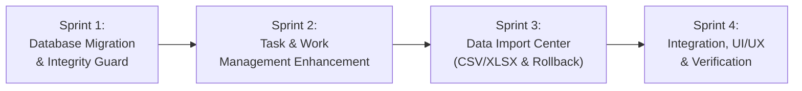

# Implementation Plan — Compliance Workspace v1.1.0

Dokumen ini adalah rencana implementasi resmi untuk pengembangan **Compliance Workspace v1.1.0** pada branch `develop/v1.1-import-task-management`. Dokumen ini telah disesuaikan dengan 15 keputusan desain dan penyempurnaan wajib yang telah disetujui.

---

## 1. Keputusan Desain & Batasan Arsitektur

1. **Parser XLSX (Microsoft Excel)**:
   - Menggunakan pustaka pure-Go `github.com/xuri/excelize/v2` versi stabil yang kompatibel dengan Go proyek.
   - Dependensi dikunci dalam `go.mod` dan `go.sum`.
   - Bekerja 100% offline tanpa CGO (`CGO_ENABLED=0`).
2. **Pemicu Tugas Berulang (*Recurring Tasks Trigger*)**:
   - Pemicu berjalan pada tiga titik:
     1. Startup server aplikasi.
     2. Background ticker berkala setiap 1 jam selama aplikasi aktif.
     3. Tombol manual *"Periksa Jadwal"* pada antarmuka pengguna.
   - Menerapkan **idempotency berbasis identitas jadwal dan periode** (`schedule_id` + `target_period_date` atau kode referensi) guna mencegah timbulnya pekerjaan duplikat saat evaluasi ulang.
   - Menangani pekerjaan yang terlewat (*missed runs*) saat aplikasi dimatikan (*offline*), dengan kebijakan terjadwal yang terdokumentasi (menghasilkan instans yang tertunggak dengan status `not_started` dan tanggal jatuh tempo yang sesuai periode aslinya).
3. **Batasan & Proteksi Impor Data**:
   - Batas maksimal berkas mentah: **10 MB** atau **5.000 baris** per batch.
   - Proteksi tambahan:
     - Pembatasan ukuran memori dekompresi XLSX (*zip bomb protection* via batas ukuran stream).
     - Pembatasan jumlah sel total (maksimal 100.000 sel per berkas).
     - Sanitasi formula injection (`=`, `+`, `-`, `@`, `\t`, `\r`).
4. **Strategi Mode Impor**:
   - Mode utama yang didukung: **Create New** (buat pekerjaan baru) dan **Skip Duplicate** (lewati duplikat).
   - **TIDAK ADA overwrite otomatis** pada pekerjaan yang sudah ada. Fitur *Update* hanya dapat dilakukan melalui konfirmasi eksplisit pengguna dan setiap perubahan atribut dicatat ke `activity_logs`.
5. **Preview Impor Read-Only**:
   - Preview membaca berkas ke memori/respons JSON tanpa melakukan modifikasi atau penyimpanan apa pun ke database SQLite aktif.
6. **Transaksi Atomik Impor**:
   - Seluruh baris dalam batch impor dieksekusi dalam satu transaksi database tunggal (`tx`). Jika terjadi kegagalan atau validasi error di tengah proses, seluruh transaksi di-*rollback*.
7. **Jejak Audit & Tindakan Kompensasi (*Compensatory Rollback*)**:
   - Log aktivitas (*Activity Log*) tetap **append-only murni** (dilindungi trigger SQLite `RAISE(ABORT)`).
   - Jika pengguna membatalkan (*rollback*) sebuah batch impor yang telah di-commit, sistem **TIDAK menghapus** baris pekerjaan atau log `created`.
   - Sistem melakukan tindakan kompensasi: menandai pekerjaan hasil impor menjadi `archived_at` dan menambahkan entri log baru berjenis `archived` dengan deskripsi kompensasi pembatalan batch impor.
8. **Integritas Penomoran & Log Tiap Pekerjaan**:
   - Setiap pekerjaan yang dibuat melalui impor wajib memiliki kode unik berurutan `CMP-YYYY-NNNNNN` dan entri log `created` di `activity_logs`.
9. **Migrasi Database Incremental & Snapshot**:
   - Migrasi dari v1.0.0 ke v1.1.0 dijalankan secara transaksional menggunakan file migrasi `002_v1_1_schema.sql`.
   - Sebelum migrasi diterapkan:
     - Verifikasi integritas database melalui `PRAGMA integrity_check`.
     - Pembuatan snapshot darurat cadangan otomatis (`pre_migration_backup_*.db`).
     - Eksekusi migrasi dalam transaksi atomik.
     - Verifikasi integritas ulang pasca-migrasi.
10. **Penanganan Ketidakcocokan Versi Skema (*Schema Version Guard*)**:
    - Sistem mencatat batas versi skema yang didukung (`MaxSupportedVersion = 2`).
    - Jika database memiliki versi skema lebih tinggi dari yang didukung aplikasi, aplikasi berhenti dengan pesan informatif agar tidak merusak struktur data.
11. **Konsistensi Relasional Database**:
    - Menegakkan `PRAGMA foreign_keys = ON`.
    - Relasi `subtasks` &rarr; `work_items` menggunakan `ON DELETE CASCADE`.
    - Relasi `import_items` &rarr; `work_items` menggunakan `ON DELETE SET NULL`.
    - Relasi `activity_logs` &rarr; `work_items` tetap `ON DELETE RESTRICT` dan append-only.
12. **Independensi Status Pekerjaan**:
    - Status pekerjaan pada Work Register **TIDAK BERUBAH OTOMATIS** menjadi `completed` meskipun seluruh subtask/checklist telah dicentang 100%. Status pekerjaan tetap berada di bawah kendali penuh petugas compliance.
13. **Keamanan & Offline-First**:
    - Mempertahankan localhost loopback binding (`127.0.0.1`), proteksi CSRF `cw_csrf_token`, CSP ketat, dan mekanisme Backup & Restore konsisten `VACUUM INTO`.

---

## 2. Tahapan Pengembangan (Sprints)

### **Sprint 1: Database Migration & Schema Compatibility (Fokus Saat Ini)**
- Buat file migrasi `internal/database/migrations/002_v1_1_schema.sql`.
- Tambahkan kolom `progress_percentage` pada `work_items`.
- Buat tabel baru: `categories`, `subtasks`, `work_templates`, `recurring_schedules`, `import_batches`, `import_items`.
- Sempurnakan `internal/database/db.go` dengan:
  - Pemeriksaan batas versi maksimum skema (*version guard*).
  - Snapshot darurat otomatis sebelum migrasi berjalan.
  - Verifikasi integritas ganda (`PRAGMA integrity_check` sebelum & sesudah migrasi).
- Buat pengujian komprehensif di `tests/migration_v1_1_test.go` menggunakan database dummy terisolasi.
- **Keluaran**: Laporan hasil pengujian migrasi, kompatibilitas database v1.0.0, dan verifikasi integritas.

---

### **Sprint 2: Work & Task Management Enhancement**
- Model domain & repository untuk Subtasks, Categories, Work Templates, dan Recurring Schedules.
- Service logika bisnis:
  - Penambahan & penyelesaian subtask dengan pencatatan audit log `activity`.
  - Kalkulasi persentase progres dinamis tanpa mengubah status `completed` secara otomatis.
  - Master kategori dengan kode warna.
  - Template pekerjaan dengan checklist bawaan.
  - Evaluasi jadwal berulang dengan logika idempotensi dan penanganan periode terlewat (*offline recovery*).
- Handler REST API dan pengujian unit/integrasi.

---

### **Sprint 3: Data Import Center**
- Integrasi dependensi `github.com/xuri/excelize/v2` pada `go.mod`.
- Parser CSV & XLSX dengan batas memori/ukuran berkas dan dekompresi aman.
- Wizard alur: Upload Read-Only Preview &rarr; Column Mapping &rarr; Dry-Run Validation & Duplicate Check &rarr; Atomic Commit.
- Mekanisme Rollback berbasis tindakan kompensasi (arsip + audit trail, tanpa penghapusan log).
- Pengujian unit/integrasi parser, pemetaan kolom, dan rollback kompensasi.

---

### **Sprint 4: Antarmuka Pengguna (UI/UX) & Verifikasi Akhir**
- Integrasi antarmuka HTML/CSS/Vanilla JS di `web/static/`.
- Komponen progress bar, checklist subtask, modal template & kategori, wizard impor data, dan riwayat batch impor.
- Pengujian akhir `node --check`, `go test ./...`, `go vet ./...`, dan `go build`.
